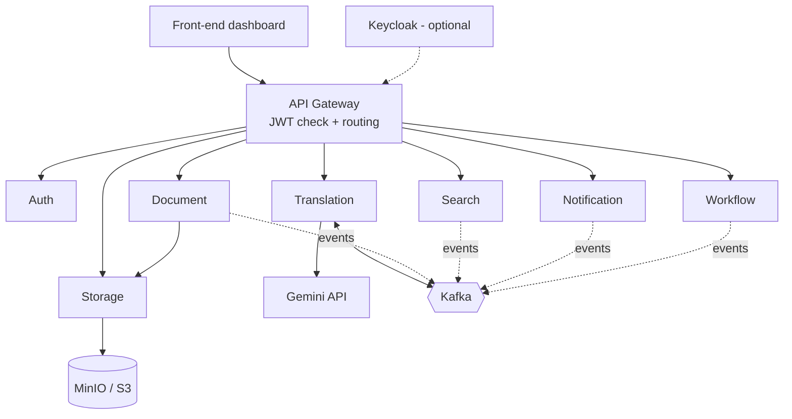

# Document Management System (DMS)

Microservices-based DMS to upload, organize, search, share, translate and collaborate on documents.

**Team:** Imene Ait Abdellah · Soumia Bouaouina · Meriem Mebarek Mensouri · Selma Mani

---

## What it does

| Area | Features |
|---|---|
| **Users** | Admin creates and manages users (roles `ADMIN`, `USER`) |
| **Documents** | Folders, upload/download, metadata, versioning, favorites |
| **Search** | Keyword search, filters, pagination |
| **Sharing** | Permissions per document: view, comment, edit |
| **Translation** | Translate text to any language with Gemini (sync or async) |
| **Workflow** | Approvals, reviews, tasks, notifications |
| **Access rule** | Users see and download only documents of **their departments** |

## Architecture



## Services

| Service | What it does | Tech | Data |
|---|---|---|---|
| **API Gateway** | Single entry point, JWT validation, routing, circuit breaker | Spring Cloud Gateway (or Nginx) | none |
| **Auth** | Login, JWT, roles, login stats | Spring Boot, Spring Security, JJWT | H2 → PostgreSQL |
| **Document** | Metadata, folders, versions, permissions | Spring Boot (WebFlux) | PostgreSQL |
| **Storage** | File upload/download to S3, file verification and validation, pre-signed URLs | FastAPI (Python) | MinIO / S3 |
| **Translation** | Translates text with Gemini, sync and async modes | Spring Boot 3.2, Java 17, WebClient, Kafka | none (results kept in memory) |
| **Search** | Full-text search, filters | Spring Boot | Elasticsearch |
| **Notification** | Alerts on changes, mentions, workflow | Spring Boot | MongoDB |
| **Workflow** | Approvals, reviews, tasks | Spring Boot | PostgreSQL |

Each service owns its data. Services stay in sync through events (Kafka).

## How a file upload works

1. User uploads a file through the gateway.
2. **Storage** validates the file (type, size) and saves it to S3.
3. **Document** saves the metadata (title, department, version, S3 key).
4. Events tell **Search** to index it and **Notification** to alert users.
5. Downloads use a **pre-signed URL** from Storage, only after Document checks the user's department.

## Security

1. `POST /auth/login`: Auth checks the **salted password hash** and returns a **JWT** (roles + departments).
2. Gateway validates the JWT once.
3. Gateway passes identity to services in headers: `X-User-Name`, `X-User-Roles`, `X-User-Departments`.
4. Document filters every query by department:

```sql
WHERE department IN (:userDepartments)
```

- Credentials live **only** in Auth.
- Keycloak can replace Auth (OpenID Connect) without changing other services.

## Translation Service

Translates text with **Gemini 2.0 Flash**. Two modes:

| Mode | Endpoint | Result |
|---|---|---|
| Sync | `POST /api/translate/sync` | Translation returned immediately |
| Async | `POST /api/translate` | `202` + `requestId`, request goes through Kafka |
| Check async | `GET /api/translate/status/{requestId}` | Translation, or `pending` |
| Health | `GET /api/health` | Service and Kafka status |

Request body:

```json
{ "text": "Hello world", "targetLanguage": "French" }
```

Kafka topics: `translation-requests`, `translation-results`.

**Run it:**

```bash
cd GeminiTranslation
docker compose up -d          # Kafka + Zookeeper
# set gemini.api.key in application.properties (or an environment variable)
./mvnw spring-boot:run
```

## Auth quick start

```bash
cd auth-service
./gradlew bootRun
```

```bash
curl -X POST http://localhost:8080/auth/login \
  -H "Content-Type: application/json" \
  -d '{"username":"admin","password":"<password>"}'
```

| User | Roles |
|---|---|
| `admin` | `ROLE_ADMIN`, `ROLE_USER` |
| `user` | `ROLE_USER` |

> Both services default to port `8080`. Change `server.port` in one of them when running locally.

## Testing

| Level | Tools |
|---|---|
| Unit | JUnit 5, Mockito |
| Integration | Spring Boot Test, Testcontainers |
| End-to-end | Cypress or Playwright |

## CI/CD

```
Commit/PR → Build → Unit tests → Integration tests
          → (merge to main) Docker images → Staging → E2E tests → Production
```

## Strengths

- One responsibility and one database per service
- Right tool for each job: SQL, search engine, S3, Kafka
- Security by design: salted hashes, signed JWTs, gateway check, department filtering in the query
- Heavy work (translation) runs asynchronously through Kafka
- Files never pass through the database: S3 + pre-signed URLs
- Automated tests and CI/CD, API docs with OpenAPI/Swagger
